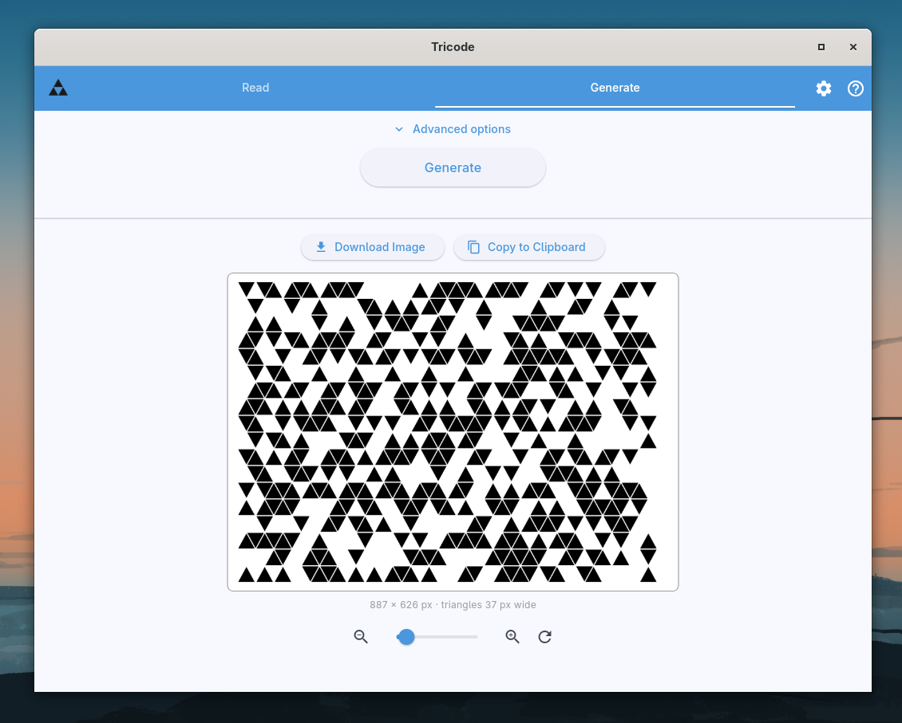
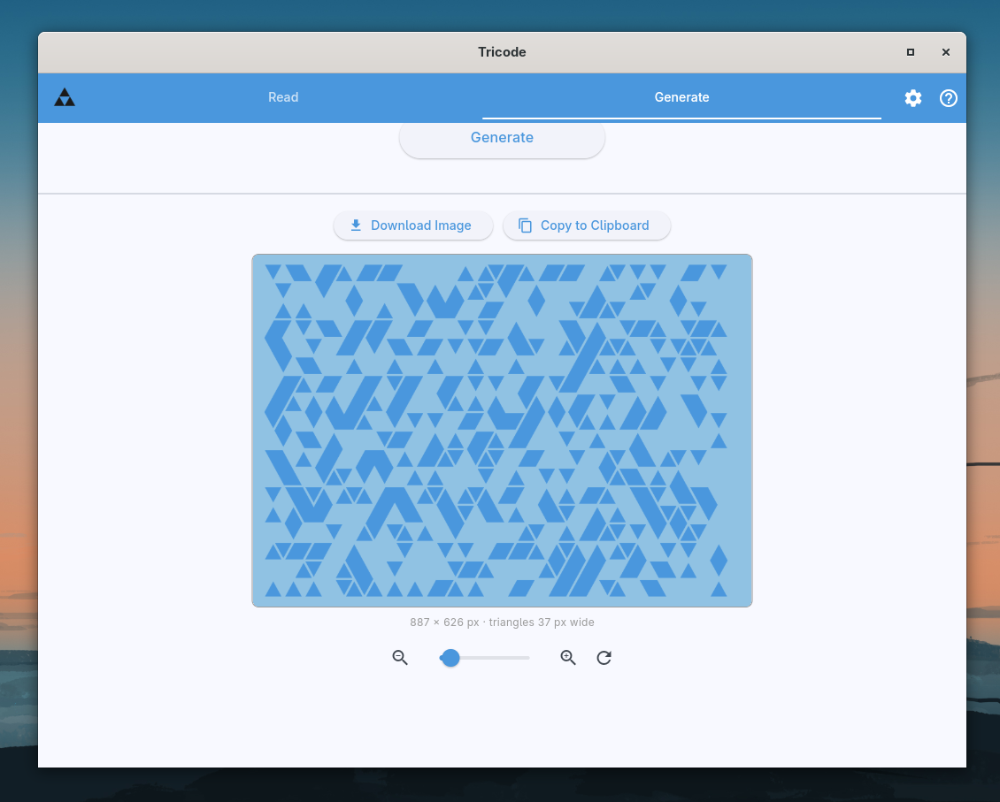
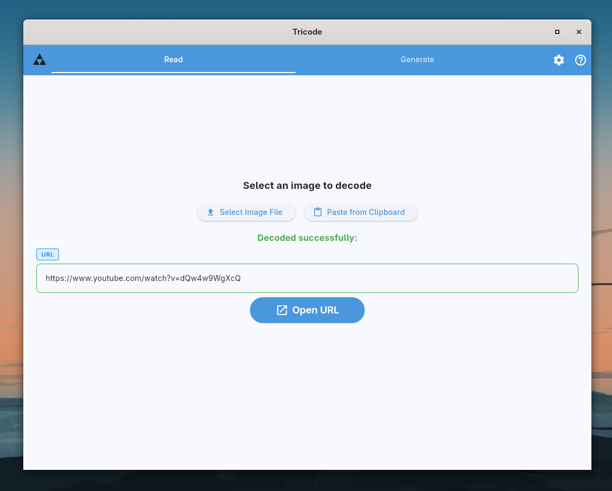
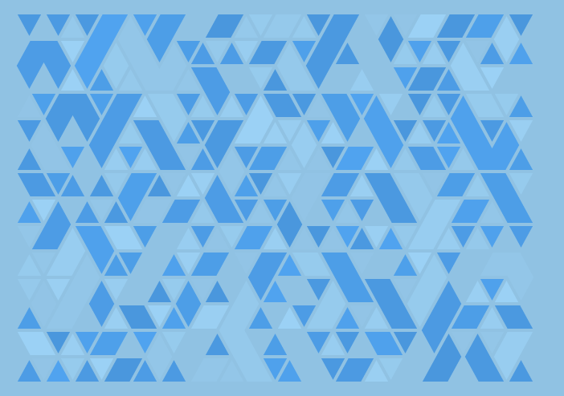

<p align="center">
  
</p>

# tricode

**tricode is a QR code reimplemented on a triangular grid.** Same idea: your
text goes in, gets framed, protected with Reed-Solomon error correction,
masked and drawn as a grid of dark and light cells. Except the cells are
triangles, because squares had their chance.

It comes as a desktop and mobile app (Flutter + Rust) and as a command-line
tool, and it both writes codes and reads them back from images.

<p align="center">
  
  
</p>
<p align="center">
  
</p>

## What it does

- **Three styles**: *Tiles* (every triangle on its own), *Horizon* (neighbours
  merge into larger shapes) and *Stain* (no borders at all).
- **Your colours**: primary, secondary and background, with presets and an
  optional per-shape colour variance, so it looks hand-made rather than
  printed by a tax office.
- **Logos in the middle**: put text or an image over the centre; error
  correction (four levels, from ~7% to ~30% damage) pays for the cells it
  covers.
- **Forgiving reader**: decodes codes that are mirrored, colour-inverted, in
  two light or two dark colours, or partly covered. Reads from a file, the
  clipboard or, on a phone, the camera.
- **Text or URL payloads**; a decoded URL gets an *Open URL* button.

## tricode vs QR code

An honest comparison.

**Where QR codes are better:**

- Every phone camera on Earth reads them.
- One pixel is enough to store a bit, so they can be smaller.
- Orientation marks are very obvious - easy to spot.
- Your mum knows what they are.

**Where tricode is better:**

- mysterious
- more triangles
- looks much better

## Inspiration

A lot of inspiration comes from game franchise **Horizon**. tricode is a fun project, not affiliated with anyone.

## Command line

The CLI, [`tricode` on crates.io](https://crates.io/crates/tricode), writes
and reads the same codes:

```shell
cargo install tricode

tricode encode "hi" -o hi.png
tricode decode hi.png
```

`decode` reads PNG, JPEG and WebP and prints the text to stdout. Run
`tricode encode --help` for styles, colours, error correction levels and logo
overlays.

## Library

Need the API rather than a binary? The encoder and decoder live in the
[`tricode-core`](https://crates.io/crates/tricode-core) crate, which both the
app and the CLI use. It's pure Rust with no UI or I/O: `generate_image_debug`
turns `GenerateImageParams` into a PNG, and `decode_image` reads PNG bytes
back.

```shell
cargo add tricode-core
```

## Building

You need the [Flutter SDK](https://docs.flutter.dev/get-started/install), the
[Rust toolchain](https://www.rust-lang.org/tools/install) (1.89 or newer) and
the CLI for [Rinf](https://rinf.cunarist.org), the Dart–Rust bridge:

```shell
cargo install rinf_cli
rinf gen        # generate the Dart bindings for the Rust signals
flutter run
```

The app builds for every platform Flutter supports natively: **Linux,
Windows, macOS, Android and iOS**. Pick one with `flutter run -d <device>` or
build a release with `flutter build linux` (or `windows`, `macos`, `apk`,
`appbundle`, `ios`). Each platform needs Flutter's usual toolchain for it
(Visual Studio on Windows, Xcode on macOS and iOS, the Android SDK and NDK for
Android); Rust is compiled for the target automatically.

It also runs in the **browser**. The Rust side is compiled to WebAssembly
first, which needs a nightly Rust toolchain and `wasm-pack` (`rinf wasm`
installs both):

```sh
rinf wasm --release         # build web/pkg/
flutter run -d chrome
```

Leave out `--release` only to debug the Rust side: an unoptimised build reads
codes 20 to 50 times slower.

`devbin/tricode-web` runs both steps, and `devbin/tricode-web-build` makes the
release bundle in `build/web` and packs it into one file,
`build/Tricode-<version>-web.zip`. Unzip it on any static host (GitHub Pages
included, or `python3 -m http.server` for a quick look, opened on
`http://localhost:8000` rather than the `0.0.0.0` address it prints); it loads
nothing from other sites, but it can't run from a `file://` URL. Over plain
http it only works on `localhost`, since browsers allow the shared memory only
in a secure context. The WebAssembly module does its work on web workers sharing memory
with the page, which browsers only allow on cross-origin isolated pages. When
the server doesn't send the isolating headers, a small service worker adds
them, so the first visit reloads the page once. Downloads replace the save
dialog, and installed fonts and the camera aren't offered in a browser.

Run the tests with `cargo test` and `flutter test`. `AGENTS.md` describes the
project layout and the code format in detail.

## What doesn't work (yet)

- **Reading from a camera is very basic and error-prone.** The reader is at
  home with clean images: saved files, screenshots, the clipboard. Photos with
  perspective, blur, glare or uneven light often fail to decode. Better
  camera reading is the next thing to improve.

## License

tricode is released under the [MIT License](LICENSE).

The bundled fonts in `assets/fonts/` (Bebas Neue, Caveat, JetBrains Mono, Lora,
Pacifico) are under the SIL Open Font License 1.1; each folder holds its
`OFL.txt`. Third-party Dart and Rust dependencies keep their own licenses.

<p align="center">
  
</p>
