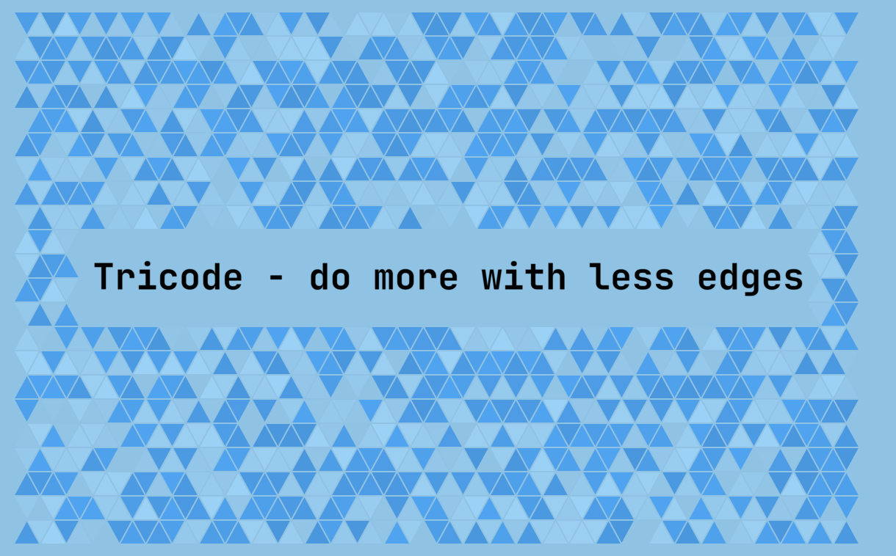

<p align="center">
  
</p>

# tricode

A Flutter + Rust app that encodes text into codes made of triangles and reads
them back from images. Codes carry Reed-Solomon error correction, so they still
decode with a logo or text in the centre, mirrored, or with inverted colours.

## Building

You need the [Flutter SDK](https://docs.flutter.dev/get-started/install), the
[Rust toolchain](https://www.rust-lang.org/tools/install) (1.85 or newer) and
the CLI for [Rinf](https://rinf.cunarist.org), the Dart–Rust bridge:

```shell
cargo install rinf_cli
rinf gen        # generate the Dart bindings for the Rust signals
flutter run
```

Run the tests with `cargo test` and `flutter test`. `AGENTS.md` describes the
project layout and the code format in detail.

## License

tricode is released under the [MIT License](LICENSE).

The bundled fonts in `assets/fonts/` (Bebas Neue, Caveat, JetBrains Mono, Lora,
Pacifico) are under the SIL Open Font License 1.1; each folder holds its
`OFL.txt`. Third-party Dart and Rust dependencies keep their own licenses.
